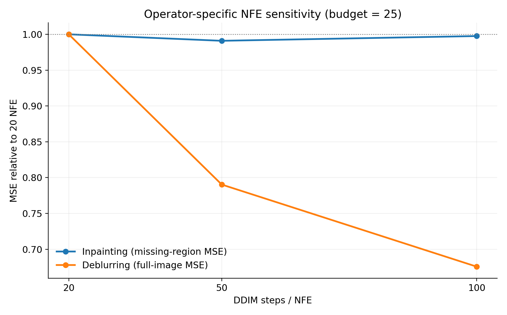

**참고:** 최초 실험은 Jupyter Notebook 환경에서 진행했습니다. 본 저장소는 코드의 가독성과 재현성을 높이기 위해 기존 실험 코드를 리팩토링한 버전입니다.

# Diffusion Models for Image Inverse Problems

A small from-scratch diffusion project exploring how measurement guidance and sampling steps affect image reconstruction. A time-conditioned U-Net is trained on Fashion-MNIST; DDIM sampling is used for center-mask inpainting and Gaussian deblurring.



With a fixed approximate guidance budget of 25, increasing DDIM steps from 20 to 100 barely changed inpainting missing-region MSE (0.0788 → 0.0786), while deblurring full-image MSE decreased from 0.0182 to 0.0123 (~32%). These are held-out results on 256 images averaged over three noise seeds. The tasks use different error regions, so only within-task trends are compared.

## Setup

```bash
pip install -r requirements.txt
python evaluate.py  # uses the included 5k-step checkpoint
```

To train a new model from random initialization:

```bash
python train.py --steps 5000
python evaluate.py --checkpoint runs/model_5000.pt
```

The reported results use the included checkpoint, trained for 5,000 steps on a 55k/5k train/validation split. Input images are resized to 32×32. Evaluation uses 20/50/100 DDIM steps, guidance strength `budget / NFE`, and a 9×9 Gaussian blur (σ=1.5) without added measurement noise.

The guidance is **DPS-inspired**, not a reproduction of DPS: it normalizes the gradient of the L2 measurement residual and applies it to deterministic DDIM updates. The budget is a heuristic scaling rule, not a conserved quantity. These experiments do not establish a causal explanation for the operator-dependent behavior.

**References:** [DDPM](https://arxiv.org/abs/2006.11239) · [DDIM](https://arxiv.org/abs/2010.02502) · [DPS](https://arxiv.org/abs/2209.14687)
